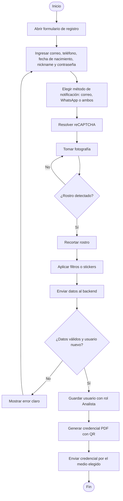
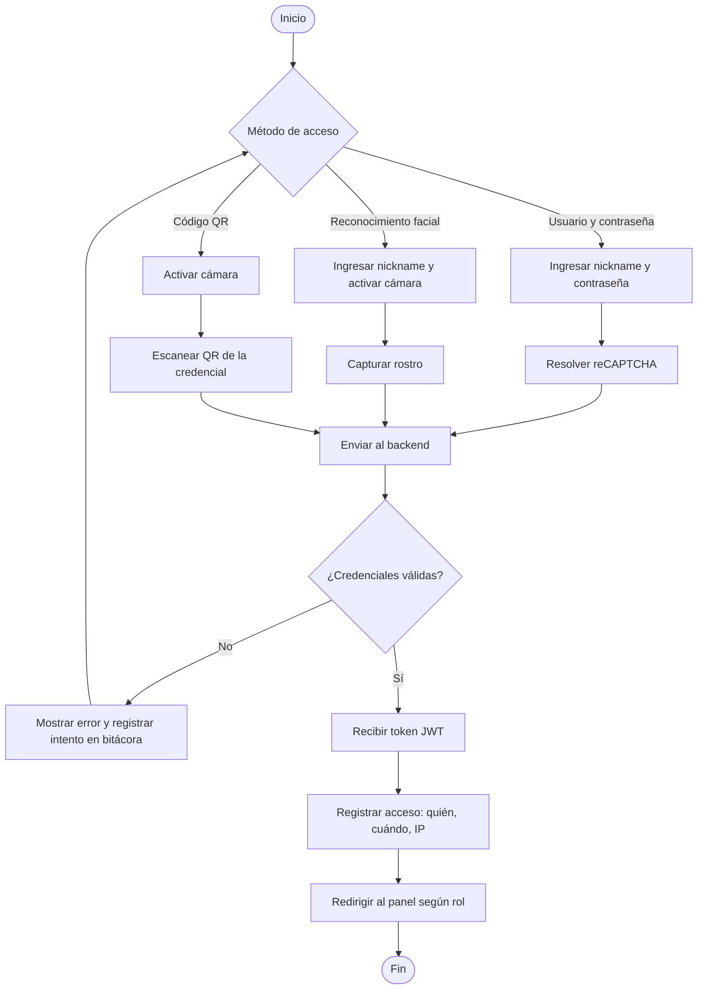
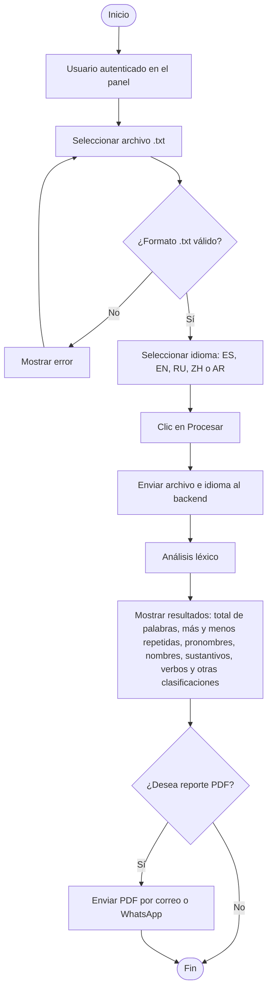
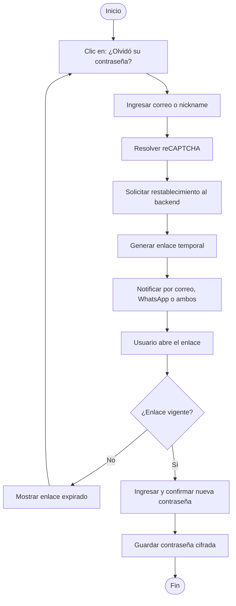

# ProyectoAutomatas
Proyecto de analizador lexico
<div align="center">

# 🔤 Plataforma de Análisis Léxico — Frontend

**Proyecto Final · Lenguajes Formales y Autómatas · 2026**


Aplicación web pública que permite registrarse, iniciar sesión (usuario/contraseña, rostro o QR) y cargar archivos `.txt` para realizar un **análisis léxico** en español, inglés, ruso, chino y árabe.

[Sitio en producción](https://[tu-dominio]) · [Manual de usuario](docs/MANUAL_DE_USUARIO.docx) · [Diagramas de flujo](#-diagramas-de-flujo)

</div>

---

## 📑 Tabla de contenido

1. [Entregables cubiertos](#-entregables-cubiertos)
2. [Tecnologías](#-tecnologías)
3. [Estructura del repositorio](#-estructura-del-repositorio)
4. [Guía para compilar el frontend](#-guía-para-compilar-el-frontend)
5. [Ejecución con Docker](#-ejecución-con-docker)
6. [Diagramas de flujo](#-diagramas-de-flujo)
7. [Manual de usuario](#-manual-de-usuario)
8. [Archivo de análisis](#-archivo-de-análisis)
9. [Seguridad](#-seguridad)
10. [Equipo](#-equipo)

---


## 🧰 Tecnologías

| Capa | Tecnología |
|------|------------|
| Framework | Nuxt 3 |
| UI | Vue 3 + Vuetify 3 |
| Lenguajes | TypeScript, JavaScript, HTML, CSS |
| Seguridad | JWT, Google reCAPTCHA, HTTPS (SSL) |
| Contenedores | Docker |
| Navegadores soportados | Google Chrome, Mozilla Firefox, Microsoft Edge |

> Backend: .NET 8 (C#) · Base de datos: [MySQL / SQL Server / Oracle]. Ver repositorio [`[nombre-repo-backend]`](https://github.com/[usuario]/[repo-backend]).

---

## 📂 Estructura del repositorio

```text
.
├── assets/                  # Estilos globales e imágenes
├── components/              # Componentes Vue reutilizables
├── composables/             # Lógica reutilizable (cámara, auth, API)
├── layouts/                 # Plantillas de página
├── middleware/              # Protección de rutas (JWT / roles)
├── pages/                   # Pantallas: registro, login, análisis, perfil
├── plugins/                 # Vuetify, reCAPTCHA
├── services/                # Consumo de la API (backend)
├── docs/
│   ├── MANUAL_DE_USUARIO.docx
│   ├── analisis/            # Archivo de análisis (1.1.2.8)
│   └── diagramas/           # Exportados de Bizagi (.bpm y .png)
├── .env.example             # Plantilla de variables de entorno
├── Dockerfile
├── instalar-dependencias.bat
├── nuxt.config.ts
├── package.json
└── README.md
```

---

## 🛠 Guía para compilar el frontend

Pasos completos **desde clonar el repositorio hasta compilar**.

### 1. Requisitos previos

| Herramienta | Versión recomendada | Verificar |
|-------------|--------------------|-----------|
| Git | 2.40+ | `git --version` |
| Node.js | 20 LTS o superior | `node -v` |
| npm | 10+ | `npm -v` |
| Docker *(opcional)* | 24+ | `docker --version` |

### 2. Clonar el repositorio

El repositorio es **privado**: debes tener acceso concedido y estar autenticado en GitHub.

```bash
git clone https://github.com/[usuario]/[repo-frontend].git
cd [repo-frontend]
```

### 3. Instalar dependencias

**Opción A: script automático (Windows)**

Haz doble clic en `instalar-dependencias.bat` (o ejecútalo desde la terminal):

```bat
instalar-dependencias.bat
```

**Opción B: manual (cualquier sistema)**

```bash
npm install
```

### 4. Configurar variables de entorno

```bash
# Linux / macOS
cp .env.example .env

# Windows (CMD)
copy .env.example .env
```

Edita `.env` con tus valores:

| Variable | Descripción | Ejemplo |
|----------|-------------|---------|
| `NUXT_PUBLIC_API_BASE` | URL base del backend (HTTPS) | `https://api.[tu-dominio]/api` |
| `NUXT_PUBLIC_RECAPTCHA_SITE_KEY` | Clave pública de reCAPTCHA | `6Lc...` |

> ⚠️ **Nunca** subas el archivo `.env` al repositorio. Está incluido en `.gitignore`.

### 5. Ejecutar en modo desarrollo

```bash
npm run dev
```

Abre <http://localhost:3000> en tu navegador.

### 6. Compilar para producción

```bash
npm run build
```

### 7. Probar la compilación localmente

```bash
npm run preview
```

### 8. Comandos disponibles

| Comando | Descripción |
|---------|-------------|
| `npm run dev` | Servidor de desarrollo con recarga en caliente |
| `npm run build` | Compilación optimizada para producción |
| `npm run preview` | Vista previa de la compilación |
| `npm run generate` | Genera sitio estático *(si aplica)* |

### 9. Solución de problemas

| Problema | Solución |
|----------|----------|
| `node` no se reconoce como comando | Instala Node.js 20 LTS y reinicia la terminal |
| Error de permisos en `npm install` | Ejecuta la terminal como administrador o limpia con `npm cache clean --force` |
| Puerto 3000 ocupado | Ejecuta `npm run dev -- --port 3001` |
| La cámara no funciona | La cámara requiere HTTPS o `localhost`; permite el acceso en el navegador |
| Error de conexión con la API | Verifica `NUXT_PUBLIC_API_BASE` y que el backend esté en ejecución |

---

## 🐳 Ejecución con Docker

```bash
# Construir la imagen
docker build -t analisis-lexico-frontend .

# Ejecutar el contenedor
docker run -d -p 3000:3000 --env-file .env --name frontend analisis-lexico-frontend
```

Aplicación disponible en <http://localhost:3000>.

Ejemplo de `Dockerfile`:

```dockerfile
FROM node:20-alpine AS build
WORKDIR /app
COPY package*.json ./
RUN npm ci
COPY . .
RUN npm run build

FROM node:20-alpine
WORKDIR /app
COPY --from=build /app/.output ./.output
ENV HOST=0.0.0.0 PORT=3000
EXPOSE 3000
CMD ["node", ".output/server/index.mjs"]
```

---

## 🔀 Diagramas de flujo

Los diagramas fueron elaborados en **Bizagi Modeler**. Los archivos originales (`.bpm`) y sus exportaciones (`.png`) están en [`/docs/diagramas/`](docs/diagramas/). A continuación, una vista rápida de cada proceso.

| Proceso | Archivo Bizagi |
|---------|----------------|
| Registro de usuario | `docs/diagramas/01-registro.bpm` |
| Login (3 formas) | `docs/diagramas/02-login.bpm` |
| Análisis léxico | `docs/diagramas/03-analisis.bpm` |
| Recuperar contraseña | `docs/diagramas/04-recuperar-password.bpm` |

### 1. Registro de usuario



### 2. Login (tres formas)



### 3. Análisis léxico



### 4. Recuperar contraseña



---

## 📘 Manual de usuario

El manual con capturas de cada pantalla está disponible en formato Word:

👉 **[Descargar MANUAL_DE_USUARIO.docx](docs/MANUAL_DE_USUARIO.docx)**

Incluye: acceso al sitio, registro, personalización de fotografía, credencial con QR, login (usuario/contraseña, rostro y QR), recuperación de contraseña, análisis léxico, reporte PDF y gestión de perfil.

---

## 🗂 Archivo de análisis

Documento de análisis del proyecto (requerimientos, alcance y decisiones de diseño):

👉 [`/docs/analisis/`](docs/analisis/)

---

## 🔐 Seguridad

- Comunicación cifrada con **HTTPS/TLS**.
- Autenticación con **JWT** para el consumo de endpoints.
- **reCAPTCHA** en registro, login y recuperación de contraseña.
- Validación y sanitización de entradas (prevención de XSS e inyección).
- Variables de entorno fuera del repositorio (`.env` ignorado por Git).
- Mensajes de error claros sin exponer información sensible.
- Buenas prácticas basadas en **OWASP**.

---

## 🎨 Diseño y compatibilidad

- Regla de color **60-30-10** (dominante, secundario y acento).
- Diseño responsivo: escritorio, laptop, tablet y móviles Android/iOS.
- Compatible con Chrome, Firefox y Edge.
- Interfaz en idioma español.

---

## 👥 Equipo

| Integrante | Rol | GitHub |
|------------|-----|--------|
| [Nombre 1] | [Backend] | [@usuario1](https://github.com/usuario1) |
| [Nombre 2] | [Base de datos] | [@usuario2](https://github.com/usuario2) |
| [Nombre 3] | Frontend, flujos y usuario | [@usuario3](https://github.com/usuario3) |
| [Nombre 4] | [Infraestructura / Docker] | [@usuario4](https://github.com/usuario4) |

**Catedrático:** [Nombre] · **Curso:** Lenguajes Formales y Autómatas · **Universidad Mariano Gálvez**

---

<div align="center">
Hecho con 💙 por el grupo [número] · 2026
</div>
